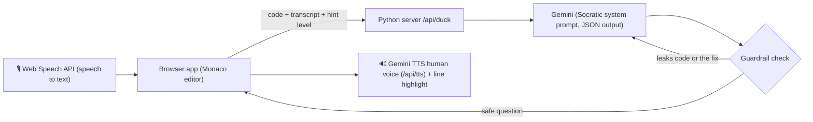

# 🦆 Quack: the rubber duck that talks back

> Explain your bug out loud. Quack asks questions until **you** find the bug.
> It never writes code and never gives you the fix.

Built for **IceHacks 2026**.

## The problem
Students learning to code now have AI that writes the fix instantly. Pasting the bug into a chatbot gets the code running, but the student often doesn't learn why it broke, and the same bug comes back next week.

Programmers have long debugged by **explaining their code to a rubber duck**. Saying it out loud makes you notice what you skipped. A normal duck can't ask follow-up questions, though.

## What it does
- 🎙️ **Talk out loud.** Explain your bug by voice (or by typing). Quack replies out loud in a real human-sounding voice (Gemini TTS).
- ❓ **Socratic questions only.** Quack asks one question at a time: expected vs. actual output, then predicting values, then tracing lines.
- 👀 **Points at your code.** The lines Quack is asking about are highlighted in the editor with a 🦆 in the margin.
- 🧭 **Hint ladder.** Click "I'm stuck" to get more specific questions (3 levels). Even level 3 is still a question.
- 🛡️ **Guardrail.** Every AI reply is checked by code before you hear it. Replies containing code blocks, new code, or instructions like "change X to Y" or "the bug is…" are rejected and regenerated. The UI shows how many answers the duck held back.
- 🧠 **Insight trail.** Your realizations are collected as you make them.
- 🎉 **Debrief.** When you fix it, you get the concept name, what you did well, 3 takeaways, and a question to ask yourself next time. The stats always show **0 lines of code written by AI**.

## How it works


**Guardrail details** ([duck_brain.py](duck_brain.py) `check_reply`): rejects code fences, multi-line code, backtick snippets or `a = b` expressions **that don't already exist in the student's code** (so the duck can still say "what is `i` on line 3?"), phrases that instruct a fix, and replies that don't ask a question. A rejected reply is sent back to the model with the reason (up to 2 retries). If it still fails, Quack falls back to a safe, generic tracing question. Covered by unit tests in [test_duck_brain.py](test_duck_brain.py).

## Run it locally
Needs only **Python 3.10+**. No packages to install.

```bash
cp .env.example .env        # then paste your Gemini API key into .env
python server.py            # open http://localhost:8000 in Chrome or Edge
python -m unittest -v       # run guardrail tests
```
With no API key, the app runs in **demo mode** with scripted questions, so you can try the UI.
Get a free key at https://aistudio.google.com/apikey.

## Deploy (free, Render)
1. Push this folder to a public GitHub repo.
2. On https://render.com → **New → Blueprint** → select the repo (it reads `render.yaml`).
3. Set `GEMINI_API_KEY` when prompted. Done. Render gives you a public `https://….onrender.com` link.

## Deploy to Vercel
The app exposes `/api/health`, `/api/duck`, and `/api/debrief` through a lightweight Python WSGI entrypoint. Frontend assets in `public/` are served by Vercel's CDN and the local Python server. Without `GEMINI_API_KEY`, the public app runs in demo mode, so judges can try the full UI without consuming API quota. To enable live Gemini responses, set `GEMINI_API_KEY` as an encrypted server-side environment variable in the Vercel project and redeploy; never commit `.env`.

> Voice output uses Gemini TTS (same API key; set `GEMINI_TTS_VOICE` to change the voice). In demo mode, or if TTS fails, it falls back to the best natural browser voice.
>
> Voice input uses the Web Speech API: **Chrome or Edge** recommended (mic needs HTTPS or localhost). Other browsers can type.

## Built with
Python (standard library `http.server`), vanilla JavaScript, HTML/CSS, Monaco Editor, Web Speech API (SpeechRecognition), Google Gemini API (chat + text-to-speech).

## AI tools used (disclosure)
- **Runtime:** Google Gemini generates Quack's questions, debriefs, and spoken voice.
- **Development:** AI coding assistants, including OpenAI Codex and Claude, helped with implementation and debugging. The team directed the work and checked the app and its guardrails.

## Challenges
- Getting an LLM to *not* help too much. Prompting alone wasn't reliable, so we added a code-level guardrail with retries.
- Allowing the duck to mention the student's existing code while still blocking new code (compare against the student's source).
- Making voice feel natural: push-to-talk, interim transcripts, and stopping speech output while listening.

## What's next
- VS Code extension, so the duck lives in your editor.
- Run the code in the browser so the duck can say "run it with this input".
- Teacher dashboard: see which concepts a class struggles with (without the AI ever doing the homework).
- Multilingual voices.
